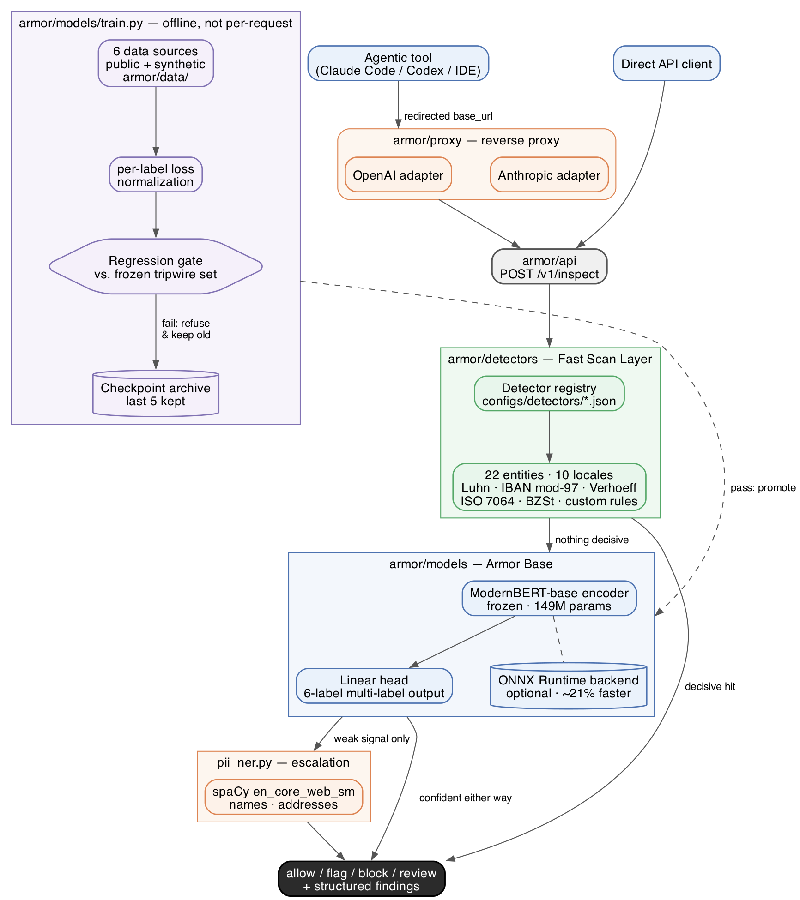
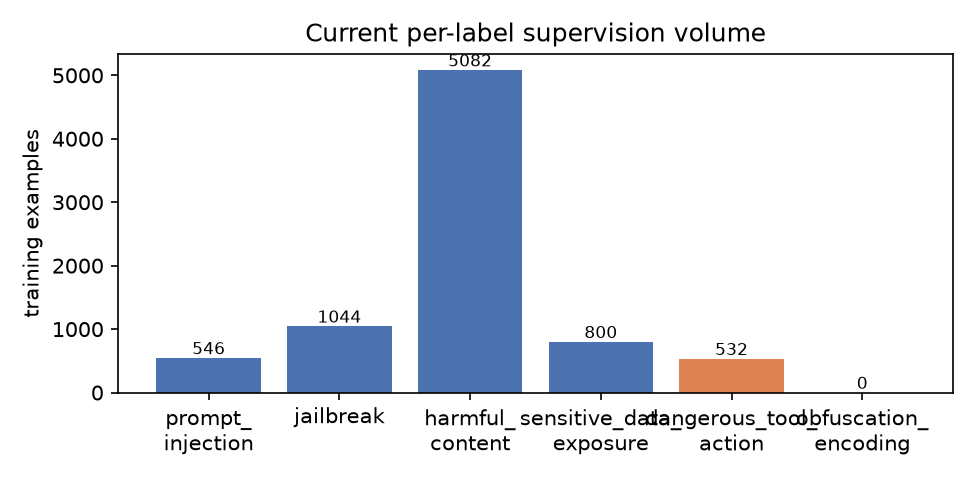

<div align="center">

# Armor

**Open-source, low-latency AI content-security engine**


Inspects prompts and model responses through a **conditional-compute**
pipeline — cheap deterministic checks first, learned models only when the
cheap checks don't already have an answer — instead of running every
detector on every request.

[Quickstart](#v-quickstart) · [Architecture](#ii-architecture) · [Coverage](#iv-coverage) · [Docs](#x-design-docs) · [Queue](#xi-open-work-queue)

</div>

---

## I. Status

Research/engineering baseline, **not** a claim of complete protection. Real
detection exists for every taxonomy label except one; see
[Coverage](#iv-coverage) for the honest, label-by-label breakdown — including
what's weak and why.

## II. Architecture

<p align="center"></p>

Each stage only runs when the one before it didn't already produce an
answer — the core "conditional compute" idea from the architecture spec.

## III. Features

| | |
|---|---|
| **`POST /v1/inspect`** | direction/content in → decision (`allow`/`flag`/`block`/`review`) + structured findings out |
| **Reverse proxy** (`armor/proxy`) | point a client at Armor instead of the provider; prompt *and* response inspected, wire format unchanged. Non-streaming responses are blocked before ever reaching the upstream when the prompt trips a block; streaming responses use a chunked-with-kill-switch relay — text is inspected incrementally as it arrives and the stream is cut with a synthetic termination event the moment it crosses the block threshold, rather than a full passthrough with no response-side inspection at all. Tool/function calls are inspected too, both streamed (OpenAI `tool_calls` deltas, Anthropic `input_json_delta`) and non-streaming — a response consisting only of a tool call, with no text content at all, previously inspected an empty string and was always allowed regardless of what the call did. Provider list is config-driven (`configs/proxy/providers.json`) — OpenAI, Anthropic, and any OpenAI-compatible provider (Groq, Together, Fireworks, Mistral, DeepSeek, OpenRouter, Gemini's OpenAI-compat endpoint, Perplexity, Cerebras, xAI seeded; add more via the admin GUI below or by editing the JSON directly, no code change) |
| **Admin GUI** (`armor/proxy/admin.py`, `/admin`) | browser page to add/remove proxy providers (applied immediately, no restart) and a request log page — every `/v1/inspect` and `/proxy` call, click a row for full prompt/response content, decision, reason, and findings. Persisted to SQLite (`armor/observability/log_store.py`), survives restarts. No auth — localhost/trusted-network dev tool only, not for public exposure |

### Connecting an existing app with zero code changes

Point the app's SDK client at Armor via that SDK's own `base_url`
environment-variable override — no source change, no proxy trust/CA
setup, works on locked-down corporate machines. Verified variables
(`armor/proxy/env_overrides.py`, shown per-provider in the admin GUI):
`OPENAI_BASE_URL`, `ANTHROPIC_BASE_URL`. For any other provider, set its
client's `base_url` constructor argument directly — don't assume a
`*_BASE_URL` env var exists without checking that SDK's own docs first.

A transparent, TLS-intercepting forward proxy (decrypt-and-inspect any
outbound HTTPS without touching the calling app at all) was considered
and rejected: it requires installing a custom root CA on the machine,
which is blocked by policy on corporate-managed devices — exactly where
this needs to work. Not revisiting this without a way around that
constraint.
| **Fast Scan Layer** (`armor/detectors`) | 22 deterministic regex/checksum entities across 10 country locales + a global pack (email, URL, IP, cloud-credential prefixes) — config-driven, no model inference |
| **Direct policy guards** (`armor/policy/bypass.py`) | Prompt-only fast rules for explicit safety-policy bypass, live or production secret disclosure, and covert data or backup actions; evaluated across the full input before model inference. Explicit current tasks are also scored separately from attached documents. [Long-text replay and limits](docs/long_text_resolution_20260923.md) |
| **BERT policy head** (`armor/models/policy_head.py`) | Active four-action head over the existing ArmorBase embedding; no second generative model call. Prompt `review` is held by the proxy. On the fresh 148-case AI-reviewer-consensus v18 gate, accuracy was 85.8% / macro-F1 0.850 versus 45.9% / 0.446 for the prior checkpoint; FLAG recall rose from 15.3% to 88.1% at 89.7% precision. [Evaluation, checkpoint, rollback, and limitations](docs/broad_accuracy_resolution_20260923.md) |
| **Armor Base** (`armor/models/armor_base.py`) | ModernBERT-base multi-label classifier, bootstrap-trained on 6 sources (public + synthetic) |
| **PII NER escalation** (`armor/models/pii_ner.py`) | spaCy NER for unstructured PII, gated behind a real conditional-compute rule — not always-on |
| **Training safety** (`armor/eval/regression_gate.py`) | every retrain is checked against a frozen regression set before it's allowed to replace the deployed checkpoint; old checkpoints auto-archived; runs are seeded and reproducible |
| **Score calibration** (`armor/models/calibration.py`) | Inductive Venn-Abers calibration remaps Armor Base's raw per-label scores against `regression_set.py` + the synthetic short/long negative generators, keyed to the deployed checkpoint's content hash. Fixes false positives on short/generic benign text (raw scores are noisy there — a classifier out-of-distribution cliff, not a decision-threshold problem) without retraining. Thresholds compare against the calibrated Venn-Abers upper bound (`p1`), not the textbook symmetric merge — an asymmetric-cost choice, matching the bandit's own reward table below: under-reacting to a real attack costs more than over-flagging a benign one |
| **Decision bandit — shadow mode** (`armor/models/bandit.py`) | LinUCB logs a recommendation but never controls the live response. Feedback now distinguishes the actual Armor decision from the bandit recommendation; provisional single-AI labels record a prospective reward without updating live weights. [Feedback targets, training filters, and evaluation](docs/feedback_targets_and_reward_loop.md) |

<details>
<summary><b>Fast Scan Layer checksum coverage</b> (click to expand)</summary>

Real checksums where one publicly exists — Luhn, IBAN mod-97, Verhoeff
(Aadhaar), ISO 7064 (China), France's mod-97 key (with Corsica
substitution), Germany's BZSt algorithm (check-digit + digit-repetition
rule). Documented rule-based checks where no checksum exists at all — US
SSN, UK NINO, India PAN (settled via Microsoft Purview's own spec after
conflicting secondary sources — see [Sources](#vii-sources-referenced-for-detector-accuracy)).

Every pattern is also audited for O(n²) regex backtracking (`tests/test_regex_complexity.py`)
since these run on **every request**.

</details>

## IV. Coverage

| Taxonomy label | Coverage | Detail |
|---|---|---|
| `sensitive_data_exposure` | Full | 22 deterministic entities (10 locales) + synthetic-trained model signal + NER escalation |
| `prompt_injection` | Bootstrap | deepset/prompt-injections + reshabhs/SPML_Chatbot_Prompt_Injection + 1,600 reviewed OASST1 code/structured/long assistant-response negatives |
| `jailbreak` | Bootstrap | jackhhao/jailbreak-classification + TrustAIRLab/in-the-wild-jailbreak-prompts + `synthetic_jailbreak_canonical.py` (300 rows), 2544 rows. Fixed and verified: frozen-set score 0.445 → **0.718** (above the pre-TrustAIRLab 0.566 baseline), and all 10/10 individual regression cases now score correctly — including the 5 short-phrase cases ("Enable developer mode" +3.04, "unfiltered model" +0.09) that were missed before the booster |
| `harmful_content` | Bootstrap | google/civil_comments + HarmBench + 800 unanimous-safe Aegis prompt negatives + 300 matched weak-slice examples |
| `dangerous_tool_action` | Weak | AgentHarm + AgentDojo + InjecAgent + ToolSafety + Agent Safety Bench + ToolEmu + synthetic, 2320 rows. Deployed frozen-head score is 0.357; isolated final-two-layer candidate v5 reaches **0.610**, with all six priority slices positive. Licensed data targets destructive changes, data exfiltration, external communication, and financial actions ([ARCHIVE-QUEUE-04 archive](docs/archive/queue/ARCHIVE-QUEUE-04_encoder_finetuning_evaluation.docx)) ([ARCHIVE-QUEUE-03 archive](docs/archive/queue/ARCHIVE-QUEUE-03_dangerous_tool_action_data.docx)) |
| `obfuscation_encoding` | Bootstrap | 1000 matched synthetic concealment examples, 1,200 reviewed OASST1 short-chat negatives, 800 unanimous-safe Aegis prompts, and 800 natural CoEdIT spelling-pair negatives ([ARCHIVE-QUEUE-02 archive](docs/archive/queue/ARCHIVE-QUEUE-02_obfuscation_encoding_pipeline.docx)) |

<p align="center"></p>
<p align="center"><sub>Actual per-label supervision volume — not an estimate, pulled from the current training pool.</sub></p>

Deferred **by design**, not forgotten: volumetric/aggregation thresholds and
Exact Data Match (`docs/Armor_Sensitive_Data_Exposure_Framework_v0.1.docx`,
sections 7/8/13/14) — real DLP-product features, parked until a dense
baseline exists and error analysis says they're actually needed.

## V. Quickstart

```bash
python3 -m venv .venv
.venv/bin/pip install -e ".[dev]"
.venv/bin/uvicorn armor.api.main:app --reload
```

```bash
curl -X POST localhost:8000/v1/inspect \
  -H "Content-Type: application/json" \
  -d '{"direction": "prompt", "content": "my card is 4111 1111 1111 1111"}'
```

Send one current user message (or one response/tool result) in `content`, not
the concatenated chat history. The proxy adapters extract the newest user
turn automatically. ArmorBase now reads the full input up to the encoder's
8,192-token limit; content beyond that limit returns `review` instead of
silently dropping the ending.

```json
{
  "decision": "block",
  "risk_score": 0.95,
  "findings": [{"label": "sensitive_data_exposure", "score": 0.95, "evidence": "payment_card:***************1111"}],
  "route": "fast",
  "latency_ms": 0.46,
  "model_version": "fast-scan-dlp-v0.1"
}
```

<details>
<summary><b>Optional extras</b> (NER escalation, ONNX backend, dataset tooling)</summary>

```bash
.venv/bin/pip install -e ".[dev,train,ner,onnx]"
.venv/bin/python -m spacy download en_core_web_sm   # PII escalation specialist
.venv/bin/python -m armor.models.export_onnx        # ~21% faster CPU inference, verified bit-for-bit-equivalent
```

</details>

<details>
<summary><b>Env flags</b> (feature flags are off by default; hardware acceleration is opt-in)</summary>

| Var | Effect |
|---|---|
| `ARMOR_USE_BASE_MODEL=1` | Route through Armor Base instead of the fast-path stub |
| `ARMOR_BASE_DEVICE=cpu` | Encoder device; production default is CPU, with an explicit `mps` override for Apple Silicon deployments |
| `ARMOR_USE_PII_NER=1` | Enable the spaCy escalation specialist |
| `ARMOR_ACTIVE_LOCALES=US,GB` | Scope national-ID detectors to specific deployments (unset = all locales active) |
| `ARMOR_BASE_THRESHOLD`, `ARMOR_ESCALATE_LOW` | Tune the flag/escalation score bands |
| `ARMOR_BASE_BACKEND=onnx` | Use the ONNX Runtime encoder export; benchmark on the target prompt lengths and hardware before enabling (long-input CPU performance can differ) |
| `ARMOR_BANDIT_FLOOR` | Score ceiling (default 0.95) above which the decision bandit is skipped entirely — the base classifier's own decision already stands with high confidence there |
| `ARMOR_BANDIT_STATE_PATH` | Override where the bandit's learned weights persist across restarts (default `armor/models/bandit_state/current.npz`) |
| `ARMOR_SEMANTIC_JUDGE_ENABLED` | Default `0` (off) — a local-LLM semantic feature layer for the bandit's ambiguous-band context, measured to make decisions worse (see QUEUE-02's v1.2 entry); code kept for future iteration, not deleted |
| `ARMOR_SEMANTIC_JUDGE_MODEL`, `ARMOR_SEMANTIC_JUDGE_LOW` | Model (default `Qwen/Qwen2.5-0.5B-Instruct`) and gate threshold (default 0.3) for the above, when enabled |

</details>

## VI. Training Data and Safety

`armor/models/train.py` trains a linear head over ModernBERT-base and can
optionally fine-tune its final encoder layers — run with
`python -m armor.models.train`.

| Source | License | Label |
|---|---|---|
| [deepset/prompt-injections](https://huggingface.co/datasets/deepset/prompt-injections) | apache-2.0 | `prompt_injection` (546 rows, 203 pos / 343 neg) |
| [reshabhs/SPML_Chatbot_Prompt_Injection](https://huggingface.co/datasets/reshabhs/SPML_Chatbot_Prompt_Injection) | MIT | `prompt_injection` (16012 rows, 12542 pos / 3470 neg) — system-prompt-violation attempts + matched on-topic benign user prompts, arXiv 2402.11755 |
| [jackhhao/jailbreak-classification](https://huggingface.co/datasets/jackhhao/jailbreak-classification) | apache-2.0 | `jailbreak` (1044 rows, 527 pos / 517 neg) |
| [TrustAIRLab/in-the-wild-jailbreak-prompts](https://huggingface.co/datasets/TrustAIRLab/in-the-wild-jailbreak-prompts) | MIT | `jailbreak` (600 of 1405 pos + 600 of 13735 neg, both capped) — real jailbreak attempts + genuine benign prompts, CCS 2024 "Do Anything Now" paper |
| [google/civil_comments](https://huggingface.co/datasets/google/civil_comments) | CC0-1.0 | `harmful_content` — 1.8M real organic comments, continuous toxicity score, thresholded and capped (2500 pos/neg) |
| [walledai/HarmBench](https://huggingface.co/datasets/walledai/HarmBench) | MIT | `harmful_content` (300 rows: chemical_biological, harassment_bullying, misinformation_disinformation, illegal, harmful, cybercrime_intrusion — mapped to a 9-category policy, see ARCHIVE-QUEUE-01; cybercrime_intrusion added 2026-10-19) |
| [JailbreakBench/JBB-Behaviors](https://huggingface.co/datasets/JailbreakBench/JBB-Behaviors) | MIT | `harmful_content` (100 harmful + 100 topic-matched benign behaviors), pinned revision |
| [PurCL/astra-agent-security](https://huggingface.co/datasets/PurCL/astra-agent-security) | MIT | `harmful_content` (400 of 1,995 malicious-code requests across 9 cyber domains), pinned revision |
| [meta-llama/PurpleLlama](https://github.com/meta-llama/PurpleLlama) `mitre_frr.json` | MIT | `harmful_content` + `dangerous_tool_action` negatives (750 benign security-coding requests that look risky), pinned commit |
| [nvidia/Aegis-AI-Content-Safety-Dataset-2.0](https://huggingface.co/datasets/nvidia/Aegis-AI-Content-Safety-Dataset-2.0) | CC-BY-4.0 + card terms | `harmful_content` (1,500 unsafe incl. all Malware rows + 1,500 safe user prompts), pinned revision |
| [Paul/XSTest](https://huggingface.co/datasets/Paul/XSTest) | CC-BY-4.0 | `harmful_content` (200 unsafe / 250 safe-but-scary-sounding; safe rows also `dangerous_tool_action` negatives), pinned revision |
| [walledai/AdvBench](https://huggingface.co/datasets/walledai/AdvBench) | MIT | `harmful_content` (520 harmful instructions), pinned revision |
| [RainWatcher/LongPIBench](https://huggingface.co/datasets/RainWatcher/LongPIBench) ([code](https://github.com/liu00222/LongPIBench)) | MIT | `prompt_injection` long-document windows; injection/splice code adapted in `armor/data/longpibench.py` |
| [nvidia/Aegis-AI-Content-Safety-Dataset-1.0](https://huggingface.co/datasets/nvidia/Aegis-AI-Content-Safety-Dataset-1.0) | CC-BY-4.0 | `harmful_content` + `sensitive_data_exposure` + `obfuscation_encoding` (800 negative rows) — unanimous human-annotated Safe prompts, pinned revision |
| [OpenAssistant/oasst1](https://huggingface.co/datasets/OpenAssistant/oasst1) | Apache-2.0 | `prompt_injection` (1,600 negatives), `obfuscation_encoding` (1,200 negatives), and DLP-clean `sensitive_data_exposure` (1,200 negatives) — reviewed English chat turns stratified by code/length/structure, pinned revision |
| [grammarly/coedit](https://huggingface.co/datasets/grammarly/coedit) | Apache-2.0 | `obfuscation_encoding` (800 negatives) — 400 natural English local-error/correction pairs, pinned revision; both sides are negative so spelling noise cannot stand in for concealment intent |
| Synthetic (`armor/data/synthetic_pii.py`) | self-generated, no license needed | `sensitive_data_exposure` — genuinely checksum-valid fake PII (Luhn/IBAN/Verhoeff), not regex-shaped noise |
| Synthetic (`armor/data/synthetic_dangerous_tool_action.py`) | self-generated, no license needed | `dangerous_tool_action` (600 rows) — code execution / cloud infra / browser automation plus destructive-action focus, with matched positive/negative pairs |
| Synthetic (`armor/data/synthetic_harmful_content.py`) | self-generated, no license needed | `harmful_content` (300 rows) — matched weak-slice examples for non-consensual sexual content, harassment/doxxing/defamation, and illegal facilitation |
| Synthetic (`armor/data/synthetic_jailbreak_canonical.py`) | self-generated, no license needed | `jailbreak` (300 rows) — reinforces short canonical DAN-style phrasing diluted by TrustAIRLab's long persona style |
| Synthetic (`armor/data/synthetic_obfuscation.py`) | self-generated, no license needed | `obfuscation_encoding` (1000 rows) — concealment-framed carrier phrases + obfuscated payloads vs. two negative pools: unrelated legitimate encoding use, and hard negatives (same payload/transform as positives, neutral carrier) |
| Synthetic (`armor/data/synthetic_short_negatives.py`) | self-generated, no license needed | all 6 labels (150 rows) — casual short chat ("hi", "thanks", "what's up") the corpus had zero examples of, causing a sharp out-of-distribution score cliff below ~7 words |
| Synthetic (`armor/data/synthetic_long_negatives.py`) | self-generated, no license needed | all 6 labels (480 rows, weighted toward `prompt_injection`) — multi-turn benign chat blobs matching the proxy's actual joined-history shape, the out-of-distribution defect's long-input counterpart |
| Synthetic (`armor/data/synthetic_topic_adjacent_negatives.py`) | self-generated, no license needed | weighted toward `harmful_content`/`dangerous_tool_action` (300 rows) — benign business/creative/gaming requests using vocabulary that overlaps with attack phrasing ("kill the background process," "destroy the competition with a marketing campaign"), added after calibration traced a specific false positive to word-choice proximity rather than length or misspelling |
| [ai-safety-institute/AgentHarm](https://huggingface.co/datasets/ai-safety-institute/AgentHarm) | MIT + safety-use clause | `dangerous_tool_action` (416 rows) |
| [UKGovernmentBEIS/inspect_evals](https://github.com/UKGovernmentBEIS/inspect_evals) (agentdojo eval) | MIT | `dangerous_tool_action` (116 rows, scraped from raw task source, harness not run) |
| [uiuc-kang-lab/InjecAgent](https://github.com/uiuc-kang-lab/InjecAgent) | MIT | `dangerous_tool_action` (79 rows: 17 benign + 62 attacker tool-misuse instructions, scraped raw — chosen over HarmBench, see ARCHIVE-QUEUE-03) |
| [jinjinyien/ToolSafety](https://huggingface.co/datasets/jinjinyien/ToolSafety) | MIT | `dangerous_tool_action` (500 of 15569 rows, capped — direct/indirect/multi-step tool-invocation harm, EMNLP 2025; licensing confirmed directly by the paper author and the HF dataset owner) |
| [aradhye/agent-safety-bench](https://huggingface.co/datasets/aradhye/agent-safety-bench) | Apache-2.0 | `dangerous_tool_action` (287 rows) — matched safe/unsafe instructions targeting destructive changes, data exfiltration, external communication, and financial actions; conflicting text-only labels removed |
| [ryoungj/ToolEmu](https://github.com/ryoungj/ToolEmu) | Apache-2.0 | `dangerous_tool_action` (322 rows) — curated risky-action descriptions paired with expected safe achievements across the same four weak slices |

Every retrain runs a **regression gate** (`armor/eval/regression_gate.py`)
against a frozen tripwire set (`armor/eval/regression_set.py`, 100 cases)
before it's allowed to overwrite the deployed checkpoint — a retrain that
quietly makes one label worse while fixing another gets caught and
refused, not silently shipped. It has already refused two real checkpoints
(2026-09-21, both a head-only and a partial-encoder-fine-tune candidate,
each trading one label's separation for another). The set was 2 cases per
side per label until that proved too noisy to act on (`dangerous_tool_action`
read 0.191, 0.213, 0.045 and 0.133 across four runs — noise
indistinguishable from a real regression, in both directions). A 2026-09-22
addition covers generic benign chat and assistant-response text
specifically — two retrains that day passed the gate as it stood while
still regressing on ordinary conversational traffic in production, because
every prior case was either a clear attack or an "obviously safe" topic
sentence, nothing resembling real chat. `tests/test_regression_set_integrity.py`
enforces the sizing and checks no case leaks into any synthetic generator
(one did, a negative shared verbatim with `synthetic_pii`'s pool, making it
a memorisation test rather than an independent check). Old checkpoints are
auto-archived (`armor/models/checkpoints/archive/`, last 5 kept). Training
is seeded (`seed=42` default) for reproducibility.

**Score calibration** (`armor/models/calibration.py`) draws its own
calibration set from the same negative-only sources used above — every
`synthetic_*_negatives` generator plus CoEdIT, Aegis, and OASST — rather
than training data directly, since the raw classifier's score distribution
on genuinely benign text is what needs correcting, not the label itself.
Attack-labeled/positive-heavy sources (AgentHarm, jailbreak_wild, etc.) are
deliberately excluded from calibration: it only needs to know what benign
looks like, and including the full training pool there would make
calibration as slow as training (the full calibration build, including
Aegis/OASST dataset downloads, takes several minutes — cached to disk per
checkpoint fingerprint afterward, so this is a one-time cost, not a
per-restart one).

Training runs on **Apple Silicon GPU (MPS)** when available — measured at
~2.5s/batch versus ~5.1s on CPU for the same 32x512 ModernBERT forward.
Set `ARMOR_TRAIN_DEVICE=cpu` to force CPU. Two things make this practical:
the frozen encoder's embeddings are computed **once** and cached rather than
recomputed every epoch (only the linear head trains per-epoch), and the
precompute pass sorts examples by length before batching. The sort matters a
lot — `padding=True` pads each batch to its longest member, and this corpus
spans ~326 to ~11977 characters, so unsorted batches ran near-max sequence
length where a single 64x512 forward costs 10.5s against 1.8s at 64x128.
Unsorted, a full pass appeared to hang; sorted, it completes in ~10 minutes.

The sort is **undone before the embeddings are returned**, and that is not
cosmetic. A first version left rows in sorted order, which made training
order depend on every row's text length — so editing one label's wording
reshuffled which rows batched together for *every other* label and changed
their converged weights. It showed up as `dangerous_tool_action` falling
0.213 to 0.045 on a run that only touched `obfuscation_encoding` phrasing,
and the regression gate refused that checkpoint. After the fix, a retrain
that changes only obfuscation data leaves the other five labels' frozen-set
scores bit-identical. `tests/test_precompute_order.py` pins this.

<details>
<summary>Candidates researched and rejected (click to expand)</summary>

Full reasoning lives in `armor/data/sources.py` (`CANDIDATE_SOURCES`) and
`docs/Armor_M1_Source_Survey_v0.1.docx`:

- `ai4privacy/pii-masking-200k`, `Isotonic/pii-masking-200k` — both
  non-commercial-restricted licenses.
- `bigcode/bigcode-pii-dataset-training` — gated, trains on scraped real
  secrets (wrong source ethically, regardless of license).

</details>

## VII. Sources Referenced for Detector Accuracy

<details>
<summary>Every checksum/format rule verified against a primary or authoritative source, not guessed (click to expand)</summary>

- Luhn (ISO/IEC 7812-1) — payment cards, Canada SIN
- [IBAN (ISO 13616) mod-97](https://en.wikipedia.org/wiki/International_Bank_Account_Number)
- [Aadhaar Verhoeff algorithm](https://de.wikipedia.org/wiki/Steuerliche_Identifikationsnummer) — UIDAI, first-digit 2-9 rule
- [Brazil CPF mod-11](https://lookuptax.com/docs/how-to-verify/cpf-verification-brazil) (Instrução Normativa RFB 1.548/2015)
- [China resident ID (GB 11643-1999) ISO 7064 MOD 11-2](https://en.wikipedia.org/wiki/Resident_Identity_Card)
- [Germany Steuer-ID (BZSt) check-digit + digit-repetition rule](https://de.wikipedia.org/wiki/Steuerliche_Identifikationsnummer)
- [France NIR/INSEE mod-97 key, Corsica substitution](https://fr.wikipedia.org/wiki/Num%C3%A9ro_de_s%C3%A9curit%C3%A9_sociale_en_France)
- [Australia TFN weighted mod-11](https://softwaredevelopers.ato.gov.au/) (ATO developer guide, incl. legacy 8-digit padding)
- [US SSN post-2011 randomization rules](https://www.ssa.gov/employer/randomization.html) (SSA)
- [UK NINO excluded prefixes (NIM39110)](https://www.gov.uk/hmrc-internal-manuals/national-insurance-manual/nim39110) (HMRC)
- [India PAN structure and holder-type codes](https://en.wikipedia.org/wiki/Permanent_account_number); checksum status settled via [Microsoft Purview's own SIT definition](https://learn.microsoft.com/en-us/purview/sit-defn-india-permanent-account-number) (`"Checksum: No"`) after conflicting secondary sources
- [Microsoft Purview UK NINO](https://learn.microsoft.com/en-us/purview/sit-defn-uk-national-insurance-number) and [US SSN](https://learn.microsoft.com/en-us/purview/sit-defn-us-social-security-number) entity definitions — used to confirm regex format coverage (dash/space-separated SSN, compact/grouped NINO)

</details>

## VIII. Testing

```bash
.venv/bin/pytest -q
```

226 tests. Includes a regex-complexity regression guard
(`tests/test_regex_complexity.py`), an adversarial-input stress suite
(`tests/test_dlp_stress.py`), a training-loss unit suite
(`tests/test_train_loss.py`, `tests/test_regression_gate.py`) that proves
the per-label loss fix and regression gate actually work, not just that
they exist, `tests/test_calibration.py` / `tests/test_bandit.py` for the
Venn-Abers calibration layer and the LinUCB decision bandit, and
`tests/test_adapters_streaming.py` / the streaming cases in
`tests/test_proxy.py` for the chunked-with-kill-switch response inspection
— including a test that forces two SSE events into one raw network read to
prove the kill switch stops at the exact offending event, not the next
chunk boundary.

## IX. Layout

```
armor/
├── api/          FastAPI service, schemas, /v1/inspect
├── proxy/        reverse-proxy mode, provider adapters
├── detectors/    deterministic regex/checksum registry (Fast Scan Layer)
├── models/       Armor Base classifier, calibration, decision bandit, PII NER specialist, training script
├── data/         dataset source registry, synthetic generators
├── eval/         regression gate + frozen tripwire set
└── core/ router/ redteam/ benchmarks/   scaffolded, not yet built
configs/detectors/  entity pack JSON (one file per locale)
queue/              open work items, research-paper style — see below
docs/               design specs (docx)
tests/
```

## X. Design Docs

| Doc | Covers |
|---|---|
| `Armor_Architecture_and_Design_v0.1.docx` | Overall pipeline, conditional-compute strategy, roadmap |
| `Armor_Threat_Taxonomy_v0.1.docx` | The six labels, multi-label rules, severity mapping |
| `Armor_Proxy_Design_v0.1.docx` | Reverse-proxy deployment mode, streaming, fail-open/closed policy |
| `Armor_Sensitive_Data_Exposure_Framework_v0.1.docx` | Entity taxonomy, detector registry design, DLP-1 through DLP-6 (built) plus DLP-7/EDM/GUI (deferred, section 1.1 explains why) |
| `Armor_M1_Dataset_Roadmap_v0.1.docx` | Dataset gaps per label, hard-negative/dedup/split plan |
| `Armor_M1_Source_Survey_v0.1.docx` | Every external dataset considered, with license verdicts |
| `Armor_Agentic_Tool_Integration_v0.1.docx` | Future work — using the proxy with Claude Code/Codex/Zed/etc, deferred, not started |

## XI. Open Work Queue

Each item below is its own short doc — problem statement, evidence
(charts/tables), reasoning, and current status — kept current, not a
write-once snapshot:

| Item | What | Status |
|---|---|---|
| [QUEUE-01](queue/QUEUE-01_proxy_manual_test_plan.md) | Verify proxy behavior across providers | In progress — automated matrix + config-driven multi-provider support (12 providers seeded) pass, including new streaming/tool-call coverage; live provider-wire checks await API keys |
| [QUEUE-02](queue/QUEUE-02_decision_bandit_shadow_mode.md) | Decision bandit: shadow mode → live/control mode | Bandit remains shadow-only. The 2026-09-24 provisional AI-consensus replay measured 48.1% agreement vs 88.0% for the active decision/head on 108 shared rows; it had 0% REVIEW recall. This is not ground-truth accuracy and did not update weights. Correction targets and provenance are separated; see [feedback-loop guide](docs/feedback_targets_and_reward_loop.md). |

Completed queue documents are archived in [`docs/archive/queue/`](docs/archive/queue/README.md); `queue/` now contains active work only.

## XII. Licensing Notice

No `LICENSE` file is committed yet. Recommendation: **Apache-2.0** for the
codebase — compatible with **every** dataset used for training under their
notice and attribution conditions: deepset, jackhhao, OASST1, and CoEdIT are apache-2.0, AgentHarm, the
agentdojo eval, InjecAgent, HarmBench, ToolSafety, TrustAIRLab, SPML, JBB-Behaviors, ASTRA, PurpleLlama
FRR, AdvBench, and LongPIBench are MIT, civil_comments is CC0-1.0, NVIDIA Aegis (1.0 and 2.0) and XSTest
are CC-BY-4.0, and the base encoder ModernBERT-base is Apache-2.0 (the shipped weights are a modified
derivative of it).

Every copyright line, the MIT and Apache-2.0 texts, CC-BY attribution with the changes Armor makes, and
citations are in [THIRD_PARTY_NOTICES.md](THIRD_PARTY_NOTICES.md) and [`LICENSES/`](LICENSES/). **Ship both
with any distribution of Armor's code or trained weights.** Two sets of terms travel with the weights:

- **AgentHarm** is MIT plus a clause that prohibits using it for purposes besides improving the safety
  and security of AI systems. Armor-derived models must stay within that purpose.
- **Aegis 1.0/2.0** dataset cards require legal compliance and prohibit trying to identify individuals
  in the data.

**Excluded on terms:** `allenai/wildguardmix` is ODC-BY, but its access gate requires certifying
research-only use, which conflicts with production deployment.

**Resolved:** `lmsys/toxic-chat` (cc-by-nc-4.0, non-commercial) has been
fully detached — see `armor/data/sources.py` for the removal note. It
supplied `harmful_content` training data; `google/civil_comments`
(CC0-1.0, public domain) replaces it. The checkpoint has been retrained
from scratch — no NC-licensed data in its lineage.
